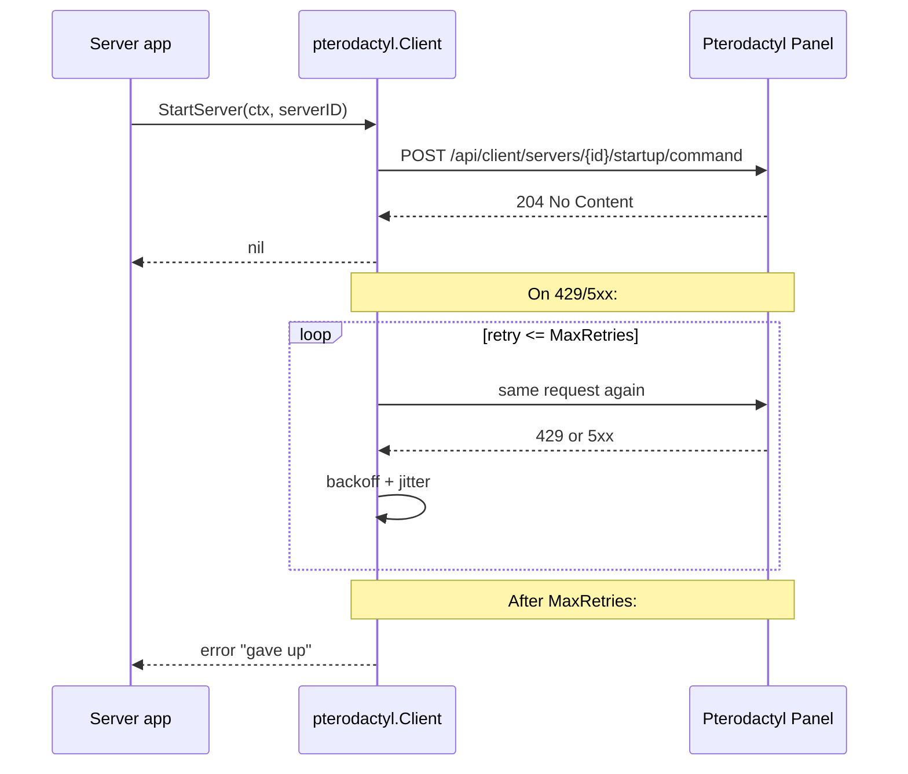
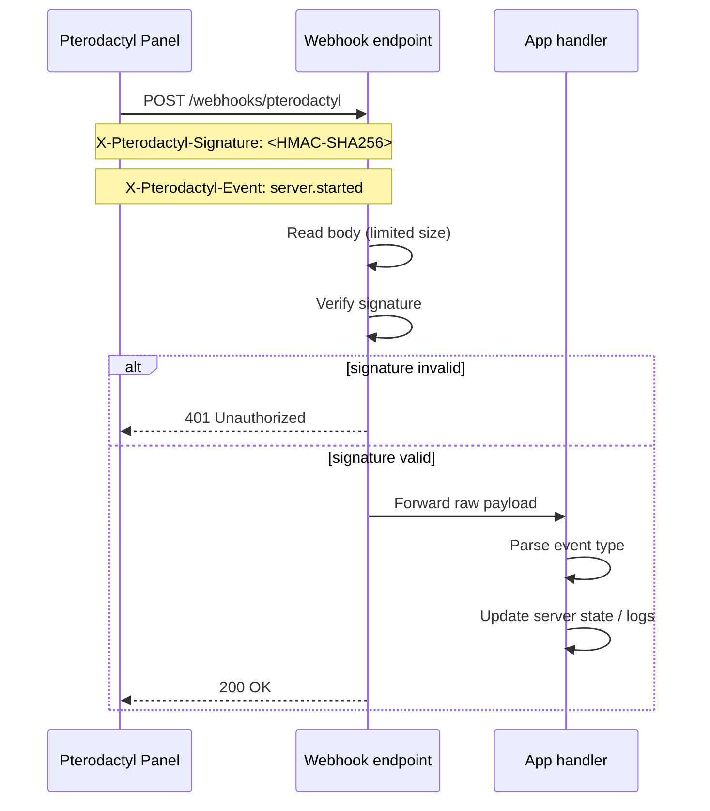

# Back-End Architecture

This document describes the high-level structure of the Go back-end living in
`server/`, with a focus on the new skin pipeline and the Pterodactyl
integration added in the current task.

## Repository layout

```text
server/
├── api/         # HTTP handlers and routes
├── auth/        # authentication and session logic
├── config/      # configuration loading
├── database/    # data access layer
├── devices/     # device/hwid binding logic
├── sessions/    # session lifecycle
├── web/         # web frontend glue, if any
├── skins/       # Minecraft skin storage, validation, avatar-head extraction
├── pterodactyl/ # Pterodactyl panel client and webhook handling
└── main.go      # application entry point
```

The new modules are intentionally kept compartmentalized:

- `server/skins` knows nothing about HTTP or the panel.
- `server/pterodactyl` knows nothing about skin storage.

That separation lets us test each concern in isolation and replace either
implementation later without impacting the other.

## Skin pipeline

### Overview

The skin system accepts a PNG skin upload, validates it, stores it, and can
later produce a 64x64 avatar-head preview suitable for chat badges and player
previews.

```mermaid
flowchart LR
    A[Client upload] --> B[HTTP handler]
    B --> C{ValidateSkinPNG}
    C -->|rejected| D[4xx response]
    C -->|ok| E[Storage.SaveSkin]
    E --> F[(LocalStorage | MemoryStorage)]
    F --> G[Persisted skin bytes]

    G --> H[ExtractAvatarHead]
    H -->|8x8 head + overlay| I[64x64 preview PNG]
    I --> J[Preview response / cached asset]

    style A fill:#e8f4fd
    style D fill:#fde2e2
    style J fill:#e8f4fd
```

The pipeline is:

1. Receive raw bytes from an HTTP upload.
2. Run `skins.ValidateSkinPNG`:
   - Must be a PNG.
   - Only 64x32, 64x64, or 128x128 are accepted.
   - Alpha channel must be present.
   - Size must be under `MaxSkinBytes` (default 2 MB).
3. Store the bytes via a `SkinStorage` backend.
4. When a preview is needed, call `skins.ExtractAvatarHead`.

### Avatar-head extraction

Extraction uses fixed Minecraft skin coordinates:

```text
Skin layout (conceptual, 64x64):

+--+--+--+--+--+--+--+--+--+--+--+--+--+--+--+--+ (0)
|  |  |  |  |  |  |  |  |sk|sk|sk|sk|sk|sk|sk|sk| (8)
|  |  |  |  |  |  |  |  |sk|sk|sk|sk|sk|sk|sk|sk| (9)
|  |  |  |  |  |  |  |  |sk|sk|sk|sk|sk|sk|sk|sk| (10)
|  |  |  |  |  |  |  |  |sk|sk|sk|sk|sk|sk|sk|sk| (11)
|  |  |  |  |  |  |  |  |sk|sk|sk|sk|sk|sk|sk|sk| (12)
|  |  |  |  |  |  |  |  |sk|sk|sk|sk|sk|sk|sk|sk| (13)
|  |  |  |  |  |  |  |  |sk|sk|sk|sk|sk|sk|sk|sk| (14)
|  |  |  |  |  |  |  |  |sk|sk|sk|sk|sk|sk|sk|sk| (15)
...
|  |  |  |  |  |  |  |  |ov|ov|ov|ov|ov|ov|ov|ov| (40)
|  |  |  |  |  |  |  |  |ov|ov|ov|ov|ov|ov|ov|ov| (41)
...

sk = skin base head region (8,8..16,16)
ov = hat/overlay region for the head (40,8..48,16)
```

The extractor:

1. Decodes the PNG.
2. Takes the 8x8 block at `(8,8)`.
3. If the skin is large enough and contains the overlay band at `y=40`, blends
   the overlay block from `(40,8)` over the head.
4. Scales the resulting 8x8 image up to 64x64 with nearest-neighbor sampling.
5. Encodes the result to PNG bytes.

This means:
- Legacy 64x32/64x64 skins get the base head only.
- 128x128 skins can include the overlay layer.

### ASCII flow diagram

```text
   +-----------------------+
   | HTTP upload handler   |
   +----------+------------+
              |
              v
   +-----------------------+
   | ValidateSkinPNG       |
   | - png.Decode          |
   | - dimensions check    |
   | - alpha check         |
   | - size check          |
   +----------+------------+
              |
        +-----+-----+
        |           |
    bad |           | good
        v           v
   +--------+   +----------------+
   | 4xx    |   | Storage.Save   |
   +--------+   +--------+-------+
                         |
                         v
                 +----------------+
                 | MemoryStorage  |  (tests)
                 | or             |
                 | LocalStorage   |  (production)
                 +----------------+

   Preview path:
   +----------------+
   | ExtractAvatarHead
   | - head 8x8 @ (8,8)
   | - overlay @ (40,8) if 128x128
   | - scale 8x8 -> 64x64
   +----------------+
```

## Pterodactyl integration

### Client

The `pterodactyl.Client` wraps a Pterodactyl Panel API client with:

- HTTP timeout (default 15 seconds).
- Bearer token authorization using the panel application key.
- Exponential backoff with jitter for `429 Too Many Requests` and `5xx` errors.
- Operations used by the current server:
  - `StartServer`
  - `StopServer`
  - `RestartServer`
  - `GetServerStatus`

All API paths are relative to the configured `baseURL`. The client is safe for
concurrent use.



### Server lifecycle flow

```mermaid
flowchart TD
    A[Admin action or API call] --> B[App wants to start/stop server]
    B --> C{pterodactyl.Client}
    C -->|StartServer| D[POST /api/client/servers/{id}/startup/command]
    C -->|StopServer| E[POST ... with STOP]
    C -->|GetServerStatus| F[GET /api/client/servers/{id}]

    D --> G[Panel provisions/starts VM]
    E --> H[Panel stops VM]
    F --> I[App reads current_state]

    G --> J[Panel emits webhook event]
    H --> J
    J --> K[Webhook endpoint in server]
```

### Webhook authentication

Pterodactyl webhooks are verified with HMAC-SHA256:

1. The panel sends a `POST` request.
2. The request includes the raw JSON body and a signature header
   (`X-Pterodactyl-Signature`).
3. The server recomputes the HMAC over the raw body using the shared secret.
4. If the signature matches, the payload is processed; otherwise the request is
   rejected with 401.



ASCII version:

```text
   +-----------+     POST /webhooks/pterodactyl        +----------------+
   | Pterodactyl|-------------------------------------->| Webhook handler|
   | Panel      |   X-Pterodactyl-Signature: <hmac>   |                |
   +-----------+                                       +-------+--------+
                                                         |
                                                         v
                                                +---------------------+
                                                | verifySignature()   |
                                                | - compute HMAC-SHA256|
                                                | - constant-time cmp |
                                                +----------+----------+
                                                           |
                                                 +---------+---------+
                                                 |                   |
                                            valid |                   | invalid
                                                 v                   v
                                          +-------------+     +-------------+
                                          | Handler     |     | 401         |
                                          | process raw |     | Unauthorized|
                                          | payload     |     +-------------+
                                          +-------------+
```

### Webhook filtering

The webhook handler can be configured with an allow-list of event types. Events
not in the list are still answered with 200 so the panel does not retry them,
but they are not forwarded to the internal handler.

This is useful for ignoring noisy or unsupported panel events while still
acknowledging them cleanly.

## Module dependencies

```text
server/
  api/
    depends on:
      - skins (optional, for upload/preview endpoints)
      - pterodactyl (for panel-controlled server actions)
      - auth
      - config

  skins/
    depends on:
      - standard library only:
        image, image/png, image/draw, bytes, fmt, os, path/filepath, strings
    used by:
      - api (upload/preview handlers)
      - tests (MemoryStorage, LocalStorage)

  pterodactyl/
    depends on:
      - standard library:
        net/http, crypto/hmac, crypto/sha256, encoding/json, context, time
    used by:
      - api (server control endpoints)
      - tests (httptest.NewServer)
```

There are no circular dependencies between `skins` and `pterodactyl`. They are
peers under `server/` and both are optional consumers of the HTTP layer rather
than the other way around.

## Error handling strategy

### Skin layer

- Validation errors are descriptive and safe to return to callers.
- Storage errors wrap the underlying cause using `fmt.Errorf("...: %w", ...)`.
- Path traversal attempts are rejected early by `ValidateSkinID` and again by
  the resolved path check in `LocalStorage`.
- Tests exercise both the happy path and rejection paths for size, format,
  alpha, and traversal.

### Pterodactyl layer

- The client treats client errors (4xx aside from 429) as terminal and returns
  them directly.
- Transient errors are retried with exponential backoff capped at 30 seconds.
- Webhook verification failures return 401 without leaking whether the problem
  was missing, malformed, or wrong signature.
- Payload size is bounded early to avoid resource exhaustion.

### General principles

- Errors are wrapped with context, not swallowed.
- No module panics in normal operation. Early configuration misuse can panic in
  constructors where continuing would be unsafe.
- The storage interface is pluggable, so backends can be swapped without
  changing validation or extraction logic.

## Security notes

- Skin IDs are validated and stored in a constrained subdirectory tree.
- Skin uploads are size-limited and format-checked before storage.
- Webhook secrets are verified with HMAC, not with plain string comparison.
- API keys are sent as bearer tokens, not logged or echoed.
- The client does not trust the panel blindly for security-critical decisions;
  it only uses the panel as an operations channel for server lifecycle.

## Testing strategy

- Skin tests generate PNGs programmatically with `image.NewRGBA` and
  `png.Encode`.
- Storage tests run against both `MemoryStorage` and `LocalStorage`.
- Pterodactyl tests use `httptest.NewServer` to simulate success, 401, 403,
  429, 5xx, and webhook signature verification.
- Webhook tests cover valid signatures, invalid signatures, missing signatures,
  wrong HTTP methods, event filtering, and oversized payloads.

## Extensibility hooks

- `SkinStorage` can be implemented by other backends without changing upload or
  extraction logic.
- `ClientOption` functions allow injecting timeouts or custom HTTP clients for
  tests and special environments.
- The webhook handler accepts a custom `WebhookHandleFunc`, so different event
  processors can be plugged in later.

## Current limitations

- The skin validator is PNG-specific by design and rejects other image formats
  even if the standard library could decode them.
- The avatar-head extraction assumes the standard Minecraft skin coordinate
  layout and does not attempt to parse texture metadata.
- The Pterodactyl client only implements the subset of the API needed right now.
- The webhook handler does not yet persist events; it forwards them to a callback
  for the caller to act on.
